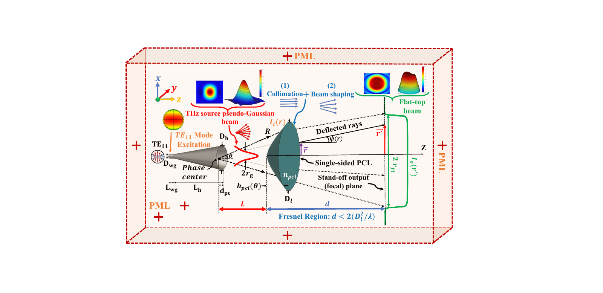

# Stand-off THz Beam Shaping

Research on single-curvature dielectric lenses that transform a divergent Gaussian millimeter-wave or terahertz beam into near-uniform, flat-top illumination at a stand-off target plane. The two studies below develop the lens profile, compare it with a conventional double-sided lens, and evaluate the resulting fields for active imaging.

## Publications and project folders

| Project | Scope | Paper |
| --- | --- | --- |
| [Applied Optics (2026)](applied-optics-2026/) | Analytical single-sided plano-convex lens design at 100 and 200 GHz, checked with integral-equation and finite-element simulations. | [Imanbeygi *et al.*, *Applied Optics* **65**, 551–557 (2026)](https://doi.org/10.1364/AO.583170) |
| [Tabriz Journal of Electrical Engineering (2026)](tabriz-journal-2026/) | A 100 GHz single-curvature lens for Gaussian-to-flat-top shaping at a 3 m stand-off distance. | [Journal article](https://doi.org/10.22034/tjee.2026.69505.5094) · [English author manuscript](tabriz-journal-2026/paper/TJEE_21653_author_manuscript.pdf) |

## What is included

- Concise project summaries, publication links, and selected figures from the author project files.
- The English-language Tabriz author manuscript, labelled separately from the journal version of record.
- A standalone MATLAB example for calculating and plotting the 100 GHz plano-convex lens profile. It uses the analytical method and parameters in the project files; it does not claim to reproduce the full simulated field results.

The local source folders also contain research notebooks, COMSOL models, CST exports, and field grids. Those materials are not part of this public selection. The *Applied Optics* [article](https://opg.optica.org/ao/abstract.cfm?uri=ao-65-2-551) states that underlying data are available from the authors on reasonable request. See [Reproducibility and further files](REPRODUCIBILITY.md) for a curated inventory and release guidance.

## Citation

If this work is useful, please cite the applicable journal article using its DOI above. The two papers are related but distinct; cite the one whose method or results you use.

## Use of materials

The publication links identify the versions of record. The Applied Optics author-revised PDF was deliberately not copied into this repository because it carries a publisher reuse notice. No license is granted for the papers, figures, or code by this repository; contact the authors for reuse beyond applicable law or the publisher's terms.
