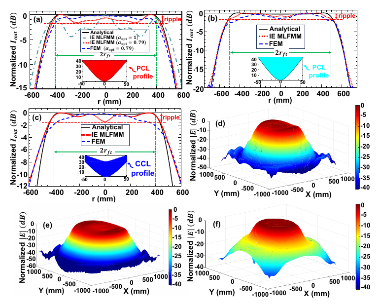

# Single-sided lens terahertz flat-top beam shaping in the Fresnel region

**Ehsan Imanbeygi, Mohammad Hossein Koohi Ghamsari, Mehdi Ahmadi-Boroujeni, and Babak Honarbakhsh**

*Applied Optics* **65**(2), 551–557 (2026). [DOI: 10.1364/AO.583170](https://doi.org/10.1364/AO.583170)

This paper derives a single-sided plano-convex lens from geometrical-optics principles. One curved surface performs both collimation and beam shaping, converting a divergent Gaussian source into flat-top illumination in the Fresnel region. Two designs are studied: 100 GHz with a 400 mm target radius at 3 m, and 200 GHz with a 500 mm target radius at 4 m. Analytical, integral-equation, and finite-element results are compared with a conventional concave-convex lens; frequency and source-alignment sensitivity are also examined.

## Figures

*Author project figure: lens and simulation geometry (Figure 3 in the author manuscript).*

*Author project figure: calculated and simulated lens profiles and flat-top output fields for the 100 and 200 GHz examples (Figure 5 in the author manuscript).*

## Reproduce the analytical lens profile

Run [`matlab/pcl_profile_100ghz.m`](matlab/pcl_profile_100ghz.m) in MATLAB. It calculates the 100 GHz single-sided lens surface from the design equations and plots its cross section. The script is a self-contained, readable adaptation of the analytical profile section in the source MATLAB notebook. It does **not** run the CST or COMSOL comparisons or regenerate the paper's field plots.

The original research notebooks are also available: [`PCL_vs_CCL.mlx`](matlab/comparison/PCL_vs_CCL.mlx) with its [field and profile exports](matlab/comparison/data/), and [`PCL_profile.mlx`](matlab/profile/PCL_profile.mlx). They are retained in their original form. Both call `SFT`, a helper function not found in the inspected project tree, and the profile notebook references additional exports not staged beside it. The two [COMSOL model files](comsol/) are tracked with Git LFS; see [reproducibility notes](../REPRODUCIBILITY.md) before using the models or notebooks.

## Paper and data

- [Publisher abstract and version of record](https://opg.optica.org/ao/abstract.cfm?uri=ao-65-2-551)
- [Supplementary information at the publisher](https://opg.optica.org/ao/abstract.cfm?uri=ao-65-2-551)
- [Author-revised manuscript PDF](paper/AO_583170_author_revised_manuscript.pdf)
- The publisher's data-availability statement says underlying data may be obtained from the authors on reasonable request. Selected exported fields and models are now included in this repository, but no claim is made that they cover every result in the article.

The manuscript's first page carries the Optica Publishing Group copyright and reuse notice. The [publisher's article abstract](https://opg.optica.org/ao/abstract.cfm?uri=ao-65-2-551) is the version-of-record link:

> © 2026 Optica Publishing Group. One print or electronic copy may be made for personal use only. Systematic reproduction and distribution, duplication of any material in this paper for a fee or for commercial purposes, or modifications of the content of this paper are prohibited.
