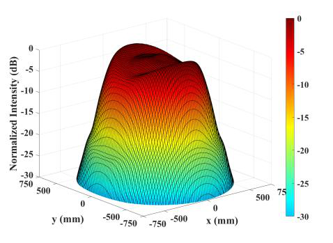

# Millimeter-wave Gaussian-to-flat-top beam shaping using a single-curvature lens

**Ehsan Imanbeygi, Mohammad Hossein Koohi Ghamsari, and Mehdi Ahmadi-Boroujeni**

Published online in *Tabriz Journal of Electrical Engineering* (2026). [DOI: 10.22034/tjee.2026.69505.5094](https://doi.org/10.22034/tjee.2026.69505.5094)

The English-language [author manuscript](paper/TJEE_21653_author_manuscript.pdf) accompanies this project. Its title is “Millimeter-Wave Gaussian-to-Flat-Top Beam Shaping Using a Single-Curvature Lens: A Novel Approach”; the journal record uses the title “Proposing a New Method for Millimeter-Wave Gaussian to Flat-Top Beam Shaping Using a Single Curved Lens.” The manuscript is not the journal version of record. No public arXiv identifier was verified from the supplied files.

The study combines a collimating profile with a beam-shaping profile on one curved lens surface. In the 100 GHz example, a lens placed 52 mm from a conical horn transforms an incident Gaussian beam of 11.9 mm radius into an approximately uniform beam of 400 mm radius at 3 m. The optimized single-sided design is compared with a previously designed double-sided lens and is assessed for frequency sensitivity.

## Representative result

*Output-plane intensity from the author's manuscript (Figure 5b).*

## Source materials

The supplied `Journal-Tabriz` folder contains manuscript versions but no original MATLAB, COMSOL, CST, or other simulation source files for this paper. Those are not inferred from the related Applied Optics project. The author manuscript is provided for reading; use the [journal DOI](https://doi.org/10.22034/tjee.2026.69505.5094) when citing the published article.
